<div align="center">

**English** · [简体中文](README.zhCN.md)

<h1 align="center">
  
  <br>GUI for zlib<br>
</h1>

A Z-Library desktop client — a **native Go GUI** built on [heartleo/zlib](https://github.com/heartleo/zlib).

</div>

---

## Introduction

This is a desktop client for Z-Library. Its core logic is built on [heartleo/zlib](https://github.com/heartleo/zlib), with the UI powered by [mygo](https://github.com/egoist/mygo).

- **Cross-platform**: Windows, macOS, Linux.
- **Fast to start, low memory**: no WebView2 / Electron dependency.
- **Synced with your account**: login, favorites, history and download quota all stay in sync with your Z-Library account.

## Features

- **Login & session**: email + password login; session persisted locally and restored on restart; Netscape-format cookie import supported.
- **Search**: keyword search + format filter (EPUB / PDF / MOBI / AZW3 and more — 11 formats in total).
- **Book lists**: recommended, most popular, favorites (two-way sync with your account), history.
- **Book details**: cover, description (rendered as Markdown), format badges.
- **Download engine**: real-time progress, cancel anytime; automatic retry on 502/503/504, 2-minute no-progress timeout, filename sanitization (path-traversal safe).
- **Download-complete notification**: system notification; the Downloads item in the sidebar shows the number of active jobs in real time.
- **Account page**: avatar, email, daily download quota / used today / remaining.
- **Domain checker (doctor)**: concurrently probes every whitelisted mirror, shows availability and latency per mirror, and switches to a working mirror in one click.
- **Network proxy**: SOCKS5 / HTTP proxy forwarding for everything (search, covers, downloads, domain probing, login preflight), persisted across restarts.

## Quick Start

Prerequisites: Go 1.27+ (`go.mod` declares `go 1.27.3`); on Windows, Direct3D 11 needs no extra runtime.

```sh
# Run
go run .

# Build
go build ./...

# Test (core unit tests mock the upstream with httptest, no network required)
go test ./...

# mygo-specific static checks
go tool mygo vet .
```

On first launch the app registers the `zlib://` deep-link scheme (this works under `go run .` too). Login data and settings are stored in
`~/.config/zlib/` (redirectable via `ZLIB_CONFIG_DIR`).

## Packaging & Releases

`mygo.json` already configures the artifact name, icon and URL scheme:

```sh
go tool mygo build                          # current platform
go tool mygo build -platform windows/amd64,darwin/universal,linux/amd64
```

Artifacts:

- Windows: executable under `build/windows-amd64/` + NSIS installer (with start-menu shortcut and uninstall entry)
- macOS: `.app` + `.dmg` (together with the style resources in `resources/app_icon.icon`)
- Linux: executable, `.desktop`, `.deb`, `.tar.gz`

The version number is injected from `mygo.json`'s `version`; the in-app About dialog and the update check read the same source.

## Configuration

### Environment variables

| Variable | Description |
| --- | --- |
| `ZLIB_DOMAIN` | Mirror domain (whitelist-validated); takes precedence over the built-in default |
| `ZLIB_PROXY` | Global proxy URL (e.g. `socks5://127.0.0.1:7890`); overridden by the GUI settings page |
| `ZLIB_DOWNLOAD_DIR` | Default download directory |
| `ZLIB_DOWNLOAD_RETRIES` | Number of download retries |
| `ZLIB_THEME` | Built-in theme name (takes precedence over config's `gui.theme`) |
| `ZLIB_CONFIG_DIR` | Config / session directory, defaults to `~/.config/zlib` |

`~/.config/zlib/.env` is loaded automatically at startup.

### Local files (`~/.config/zlib/`)

| File | Contents |
| --- | --- |
| `session.json` | Cookie session after login, shared with the CLI / Agent plugins |
| `config.json` | App config: `gui` block (download directory, default format, page size, proxy) + last login email |
| `.env` | Persisted environment variables (e.g. the mirror domain after switching) |

## Desktop Integration

| Capability | Behavior |
| --- | --- |
| `zlib://` deep link | Accepts only `zlib://book/{id}/{hash}`, resolves to and opens the book detail page |
| Single-instance lock | A second launch forwards its arguments to the running instance and brings it to the front, without starting a duplicate |
| System notification | Sent when a download finishes; clicking it opens the downloads page |

## Project Structure

```
zlib-gui/
├── main.go                 # Wiring: single-instance, deep links, notifications, window & event loop
├── mygo.json               # mygo packaging config (name/identifier/version/urlSchemes)
├── go.mod / go.sum         # pins mygo v0.8.3
├── core/                   # domain layer (zero UI dependency)
│   ├── client.go           #   HTTP session, cookies, credential-stripping redirects
│   ├── eapi*.go            #   EAPI protocol: login/search/detail/lists/quota
│   ├── domain_policy.go    #   mirror domain whitelist
│   ├── domain_probe.go     #   /eapi/info/domains health-probe state machine
│   ├── download.go         #   download, retry, timeout, filename sanitization
│   ├── store.go            #   session.json / config.json / .env persistence
│   ├── cookies.go          #   Netscape cookie import validation
│   ├── backend.go          #   assembles the Service implementation
│   └── demo.go             #   demo backend for tests
├── app/                    # UI layer (mygo/ui)
│   ├── app.go              #   App state, View entry, sidebar, theme application
│   ├── home.go             #   Home / account page
│   ├── search.go           #   Search and format filter
│   ├── library.go          #   Recommended / Most Popular / Favorites / History
│   ├── detail.go           #   Book detail modal
│   ├── downloads.go        #   Download queue and progress
│   ├── doctor.go           #   Domain checker
│   ├── settings.go         #   Settings / proxy / about / updates
│   ├── login.go            #   Login modal + cookie import
│   ├── desktop.go          #   Deep-link parsing, single-instance bring-to-front
│   ├── theme.go            #   Built-in theme palettes → ui.Theme
│   └── updates.go          #   Version check
└── resources/              # app icon
```

## Testing

- **core unit tests**: mock the upstream with `httptest`, covering EAPI mapping and error envelopes, credential-stripping redirects, atomic download / retry / cancel, filename path-traversal, the domain-probe state machine, session / `.env` round trips, cookie filtering, and config `gui` block read/write.
- **view tests**: `ui.NewTester` renders without a window and clicks / types / asserts semantic text like a user, covering login validation, search, recommended / popular loading, settings persistence, deep-link parsing, and the download-complete notification.
- **smoke tests**: `main_test.go` builds and renders with the real `core.NewBackend()` to verify the app starts cleanly with no network and no session.

## Acknowledgements

- [heartleo/zlib](https://github.com/heartleo/zlib) — the Z-Library CLI
- [mygo](https://github.com/egoist/mygo) — native desktop UI in Go

## Disclaimer

This project is for learning and lawful personal use only. Do not use it for any copyright-infringing or illegal purposes;
how downloaded content is used is the sole responsibility of the user.
